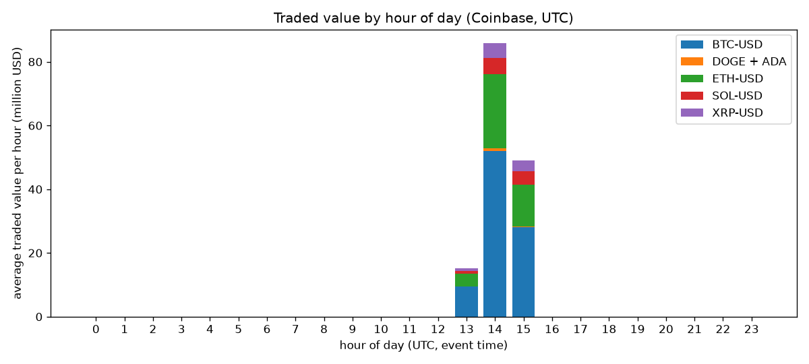

# Cyrpto Trades - Coinbase

**Author:** Evelyn Rosales Mendez
**DS 3022 Data Project 3, Fall 2026**

## Data source

- Coinbase Exchange trades: is an official public market source where people can access digital asessts quickly to buy or sell. Whenever anything is traded the delivery consists of real cryptocurrencies at the actual-current market price (Feed: wss://ws-feed.exchange.coinbase.com)
- This is a stream-live, push based source that is retrieved via WebSocket. You don't need an account or an API key. But you must make sure you have subscribe message within 5 seconds of connecting to the source or else the connection will close. 
- This project uses WebSocket to retrive Coinbase's messages describing trades. This looks like the; type, trade_id, product_is, side (which says whether it was bought or sold), price, size, time, and sequence. Limitations we face consist of messages being dropped, connection closing and reconnection after a pause. 

## How to run

What you will need: 
- Docker Desktop (running)
- Python 3.12+
- Git.

### 1. Setup
2. Find this repoistory: https://github.com/evelynxanaxia/ds3022-streaming.git
    a. DO NOT clone it, click on the green button that says 'Code' and download zip.
3. Unzip the the files and ensure the name is 'ds3022-streaming' if it's not =, rename it.
4. Open up 4 terminals. Start up your terminals with a virtual envoirnment. Then install the packages required. In your terminal 1 install prefect maplotlib
    a. python3 -m venv .venv --> source venv/bin/activate
    b. pip install -r requirements.txt
    c. pip install prefect matplotlib
5. Create your '.gitignore' file and add these to it (data/, charts/, *.duckdb, .venv/)
```bash
git clone https://github.com/evelynxanaxia/ds3022-streaming.git
cd ds3022-streaming
python3 -m venv .venv
source .venv/bin/activate
pip install -r requirements.txt
pip install prefect matplotlib
```

### 2. Start the Kafka cluster (Redpanda)
```bash
docker compose up -d
docker exec -it redpanda-0 rpk cluster info      # check that it lists 3 brokers
docker exec -it redpanda-0 rpk topic create coinbase_trades -p 3 -r 3
```
Console: http://127.0.0.1:8080. If you get "container name already in use",
run `docker rm -f redpanda-0 redpanda-1 redpanda-2 redpanda-console` and repeat.
This removes the cluster if in use and allows you to recreate it. 

### 3. Collect data (full run)
Each command below runs in its own terminal, with the venv activated:
```bash
cd project3
python producer.py      # T1: Coinbase trades -> Kafka (leave running)
python lander.py        # T2: Kafka -> data/raw/*.parquet (leave running)
python four_numbers.py product_id,trade_id    # T3: check the count
```
50,000 raw records takes about 40 minutes to 2 hours (about 23 trades per second,
slower at night). Stop both with Ctrl+C once raw >= 50,000 and the lander has
written its last batch (wait 60 s).

### 4. Start Prefect (own terminal, keep running)
```bash
prefect config set PREFECT_API_URL=http://127.0.0.1:4200/api
prefect server start     # dashboard: http://127.0.0.1:4200
```

### 5. Run the flow
```bash
cd project3
python flow.py                # full data -> charts/<your_chart>.png
python flow.py data/sample    # committed sample -> charts/<your_chart>_sample.png
```
Run the sample twice: the log should show the same four numbers, matching
the sample column in the table below, and end with `Completed()`.

### 6. Stop your docker when done
```bash
docker compose down     
# remember to not use -v because it deletes the topic data
```

## Architecture

_(replace: a diagram (an image in docs/ or a text diagram) of producer → topic → lander → raw Parquet → flow tasks → tables → charts, with the names of your files, topic, tables and charts.)_

## Design decisions

Answer each in 2-4 sentences, in your own words, with your own numbers.

1. **Key and partitions.** _(replace: which key, why, and what it guarantees about order. What would go wrong with another key?)_
2. **Batch size and time.** _(replace: your batch size and time limit. With your source's rate, which rule closes most batches? How many files per hour does that make?)_
3. **Offsets after the file.** _(replace: what happens if the lander crashes after writing a file but before storing offsets, and why you accept that.)_
4. **Duplicates.** _(replace: what makes two records the same Kafka record, and what makes them the same thing. Which SQL removes each kind?)_
5. **Windows and time.** _(replace: which time column your analysis uses (event time or landing time), which window size, and why.)_
6. **Ten times the volume.** _(replace: what in your pipeline would break or slow down first at 10x your rate, and what you would change.)_

## Chaos round

| Card | Prediction | What I did | Numbers before → after | Explanation |
|---|---|---|---|---|
| D1 Crash between file and offsets | The messages will be reread and rewritten. | Wrote`python lander.py crash` which writes one file, prints `CRASH (on purpose)` and exits **before** storing offsets. | 121,000 raw and 1 malformed, unique Kafka records were 119,999. The gap of 1,000 is exactly the crashed batch landed twice. | The command makes the program read the same records again and but this time it writes them to a second file. |
| D2 Poison message | The lander keeps running; malformed goes from 0 to 1. | TODO | TODO | TODO |
| D3 Broker down  | TODO | TODO | TODO | TODO |

## The four numbers

From the flow log on the full data (screenshot in `docs/`):

| Number | Full data | Sample (`data/sample`) |
|---|---:|---:|
| Raw records landed | 129,410 | 5000 |
| Malformed (kept in raw) | 1 | 0 |
| Unique Kafka records | 128,381 | 4999 |
| Unique TODO (your entity) | 128,381 | 4999 |

## Challenges / Obstacles

_(replace: what this source made hard in gathering, processing and analysis, and how you worked through it. What methods and tools did you use?)
At first I found setting up this project challenging because I didn't have an understanding of how to use kafka in a project, but with the slides I was able to figure out how exactly to set up my files so that everything worked well together. I think that gathering the data at first was confusing but once I did it and reviewed the numbers and information I was given after running my files, the process started to make sense. I used all of the slideshows for each session and the catch-up files to review what I had done in my pervious sessions and to update this README file.


## Analysis

My intial research question was about which hours of the day carry the most traded value in USD, and in viewing my chart I can see that 13:00-15:00 (1-3pm EST) are the hours in which most traded value is done in USD. This makes sense because it is usually after lunch where people have more energy and are back at their desk to trade. We can also see that BTC is the product that dominates the most in USD regardless of the time. This was surprising to me because I expected one product to dominate but not as much as BTC is as compared to other products. A limitation that my data has is that it doesn't account for other currencies of the world, so we are only able to view the USD traded values but we have no other currency to compare it to. 

## Plot / Visualization

I changed my chart to show the which hours of the day (UTC) carry the most traded value in USD on Coinbase. I wanted the chart to show if the value is dominated by one product as well.



## Reflection

_(replace: about 150 words, first person. What did you learn about streaming systems that you did not know before Thu 22 Oct? What would you do differently if you started again?)
This may sound silly but before this project I did not know that we are able to access any public stream-live data source and analyze it. I thought that each website had a special protection that prevented people outside of their network to see and gather the data that they keep track of. I also learned a lot about Kafka and how it organizes events into topics that is then broken down into partitions and spread across multiple servers. I didn't know that it was an open-source, distributed event streaming platform used to collect, store, and process massive volumes of real-time data streams. I find it fasinating that we have access to tools like this to create our own projects and explore the data that is publicly collected on cites. If I were to do this project again I would most likely try to make my project more complex by seeing at which hours of the day the top 5 currencies in the world carry the most traded values because I think it would be cool to see if there is any overlapping or connections between them since they are the top 5 currencies. 

## Acknowledgements

_(replace: everyone who helped you and how (classmates, instructor, online sources), code you reused (for example connection code from probe.py), and any AI assistance: what for, and how you checked the result. Write "None" if there is nothing to declare.)_
